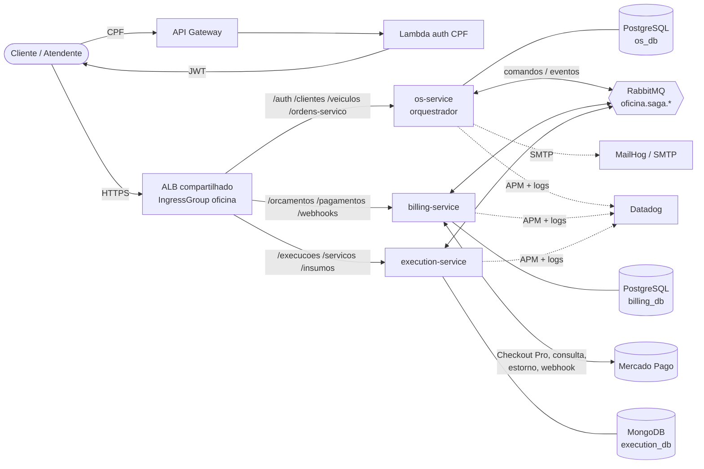

# os-service — Ordem de Serviço e orquestrador da Saga

Microsserviço responsável pelo **ciclo de vida da Ordem de Serviço** (abertura, status, histórico), pelos
cadastros de **clientes e veículos**, pela **autenticação de funcionários** e pela **orquestração da Saga**
que coordena os demais microsserviços da oficina.

> Tech Challenge SOAT — Fase 4. Repositórios do sistema:
> **os-service** (este) · [billing-service](../fiap-tc4-billing-service) · [execution-service](../fiap-tc4-execution-service)
> · infraestrutura compartilhada: `fiap-tc3-infra-k8s` (EKS, RabbitMQ, Datadog) e `fiap-tc3-lambda-auth` (login por CPF).

## Arquitetura geral



| Microsserviço | Responsabilidade | Banco | Por quê |
|---|---|---|---|
| **os-service** | Clientes, veículos, OS, histórico, **orquestrador da Saga** | PostgreSQL | Dados cadastrais e estado da Saga são relacionais e exigem transação ACID junto com o outbox |
| **billing-service** | Orçamento, pagamento Mercado Pago, estorno | PostgreSQL | Dados financeiros: consistência forte, unicidade (1 orçamento por OS), lock otimista |
| **execution-service** | Fila da oficina, diagnóstico, reparo, catálogo e estoque | **MongoDB** | A execução é um documento autocontido (itens, reservas, histórico, outbox) lido inteiro na fila; estoque com `$inc` condicional atômico |

Nenhum serviço acessa o banco de outro: dados de outros contextos chegam apenas por mensagens
(ex.: itens e preços do diagnóstico viajam no evento `execution.diagnostico-concluido` e ficam como *snapshot* na OS).

## Saga Pattern — estratégia escolhida: **orquestração**

### Fluxo

```mermaid
sequenceDiagram
    autonumber
    participant A as Atendente/Cliente
    participant OS as os-service (orquestrador)
    participant EX as execution-service
    participant BI as billing-service
    participant MP as Mercado Pago

    A->>OS: POST /ordens-servico
    OS->>EX: cmd execution.iniciar-diagnostico
    EX-->>OS: evt diagnostico-iniciado / diagnostico-concluido (itens + preços)
    OS->>BI: cmd billing.gerar-orcamento
    BI-->>OS: evt orcamento-gerado
    A->>BI: POST /orcamentos/{id}/aprovar
    BI->>MP: cria preferência (Checkout Pro)
    BI-->>OS: evt orcamento-aprovado (link de pagamento → e-mail ao cliente)
    MP->>BI: webhook payment (x-signature validada; status consultado na API)
    BI-->>OS: evt pagamento-confirmado
    OS->>EX: cmd execution.iniciar-execucao
    EX->>EX: reserva estoque (atômica, tudo ou nada)
    EX-->>OS: evt execucao-iniciada / execucao-finalizada
    OS->>OS: OS FINALIZADA · Saga CONCLUIDA
```

### Compensações (rollback seguro)

O orquestrador decide **o que desfazer conforme o ponto em que o fluxo parou** (estado persistido em `sagas_ordem_servico`):

| Gatilho | Etapa | Compensações disparadas |
|---|---|---|
| Orçamento rejeitado | APROVAÇÃO | `billing.cancelar-orcamento` + `execution.cancelar-execucao` |
| Pagamento recusado (Mercado Pago) | PAGAMENTO | `billing.cancelar-orcamento` + `execution.cancelar-execucao` |
| Estoque insuficiente na reserva | EXECUÇÃO | **`billing.estornar-pagamento`** (refund no Mercado Pago) + `execution.cancelar-execucao` |
| Prazo de aprovação/pagamento expirado | APROVAÇÃO / PAGAMENTO | idem à etapa (job `SagaTimeoutScheduler`) |
| Cancelamento solicitado (`POST /ordens-servico/{id}/cancelar`) | qualquer etapa antes do reparo | conforme o que já foi efetivado |
| Pagamento aprovado **depois** do cancelamento | Saga já compensada | estorno adicional automático |

Cada compensação fica **pendente** na Saga até o participante confirmar (`orcamento-cancelado`,
`pagamento-estornado`, `execucao-cancelada`); só então a Saga passa a `COMPENSADA`. A OS vai para `CANCELADA`
com o motivo registrado no histórico.

### Por que orquestração e não coreografia

- **Fluxo longo e com espera humana** (aprovação e pagamento): um ponto central com o estado da Saga permite
  aplicar prazos, cancelamento sob demanda e decidir compensações por etapa — na coreografia essa lógica ficaria
  espalhada e cada serviço precisaria conhecer os eventos dos demais.
- **Rastreabilidade**: `GET /ordens-servico/{id}/saga` mostra etapa, status, compensações pendentes e o log de
  todos os comandos/eventos — essencial para operação e auditoria em escala nacional.
- **Baixo acoplamento dos participantes**: billing e execution só conhecem os próprios comandos e publicam os
  próprios eventos; não dependem uns dos outros.
- **Trade-off assumido**: o orquestrador é um componente crítico — mitigado com estado persistido (retoma após
  restart), réplicas com HPA e mensageria durável.

### Garantias de consistência implementadas

- **Transactional Outbox** (`outbox_mensagens`): mudança de estado e comando são gravados na mesma transação;
  o `OutboxRelay` publica com *publisher confirms*. Sem *dual write* entre banco e broker.
- **Inbox / idempotência** (`mensagens_processadas`): entrega *at-least-once* do RabbitMQ não reprocessa eventos.
- **Retry + DLQ**: falhas transitórias são reentregues (4 tentativas, backoff exponencial); depois vão para
  `os-service.saga-eventos.dlq` para inspeção.
- **Eventos fora de ordem** são ignorados com registro no log da Saga (não reenfileirados).
- **Lock otimista** (`@Version`) em OS e Saga.

## API

Swagger UI: `http://localhost:8080/swagger-ui.html` (OpenAPI em `/v3/api-docs`). Coleção Postman em
[`docs/postman/oficina-fase4.postman_collection.json`](docs/postman/oficina-fase4.postman_collection.json).

| Método | Rota | Descrição |
|---|---|---|
| POST | `/auth/login` | Login de funcionário (JWT compartilhado pelos 3 serviços) |
| CRUD | `/clientes`, `/veiculos` | Cadastros |
| POST | `/ordens-servico` | Abre a OS e inicia a Saga |
| GET | `/ordens-servico` | OS em andamento (ordenadas por proximidade da conclusão) |
| GET | `/ordens-servico/{id}` · `/historico` · `/saga` | Status, histórico de status e rastreamento da Saga |
| GET | `/ordens-servico/cliente/{clienteId}` | OS de um cliente |
| POST | `/ordens-servico/{id}/cancelar` | Cancela e compensa |
| PATCH | `/ordens-servico/{id}/entrega` | Registra a entrega do veículo |

## Executando

```bash
# Somente este serviço (Postgres + RabbitMQ + MailHog)
cp .env.example .env && docker compose up --build

# Sistema completo (3 serviços, 3 bancos, RabbitMQ, MailHog) + teste ponta a ponta da Saga
docker compose -f docker-compose.full.yml up --build -d
./scripts/e2e-saga.sh
```

O `e2e-saga.sh` valida três cenários contra os serviços reais: fluxo feliz até a entrega, falha de estoque com
**estorno do pagamento** e rejeição do orçamento. Painéis: RabbitMQ `http://localhost:15672` (oficina/oficina),
MailHog `http://localhost:8025`.

## Testes e qualidade

```bash
./mvnw verify   # unitários + BDD (Cucumber) + integração (H2) + gate JaCoCo ≥ 80%
```

- **BDD**: [`src/test/resources/features/saga_ordem_servico.feature`](src/test/resources/features/saga_ordem_servico.feature)
  — fluxo completo da OS e 4 cenários de compensação (relatório em `target/cucumber-report.html`).
- **Cobertura**: 96% de linhas (JaCoCo, `target/site/jacoco/index.html`); o build falha abaixo de 80%.
- **Qualidade**: SonarQube no CI (job `quality`) com quality gate.

<!-- Evidências: substituir pelos prints do pipeline / relatório JaCoCo / SonarQube -->

## CI/CD (`.github/workflows/ci-cd.yml`)

| Job | Quando | O que faz |
|---|---|---|
| `build-test` | PR e push | Build, testes unitários, BDD, integração e gate de cobertura; publica relatórios |
| `quality` | PR e push | SonarQube (efêmero no runner ou servidor externo via `SONAR_TOKEN`) com quality gate |
| `docker` | PR e push | Build da imagem; push para o GHCR na `main` |
| `deploy-kind` | PR e push | Deploy automatizado em Kubernetes efêmero (kind) com Postgres + RabbitMQ e smoke test |
| `deploy-eks` | push na `main` com `DEPLOY_TO_AWS=true` | Push para o ECR, segredos reais e rollout no EKS |

**Branch protegida**: `main` exige PR e as checagens `build-test`, `quality` e `deploy-kind` aprovadas
(GitHub → Settings → Branches → *Require a pull request* + *Require status checks*).

Secrets/variáveis do deploy EKS: `AWS_ACCESS_KEY_ID`, `AWS_SECRET_ACCESS_KEY`, `AWS_SESSION_TOKEN` (sessão do
AWS Academy Learner Lab — o lab não permite OIDC/IAM roles para o GitHub), `JWT_SECRET`, `ADMIN_PASSWORD`,
`DB_PASSWORD`, `RABBITMQ_PASSWORD`; vars `AWS_REGION`, `EKS_CLUSTER_NAME`, `DEPLOY_TO_AWS`.

## Kubernetes (`k8s/`)

Namespace `oficina`: ConfigMap/Secret, **PostgreSQL próprio em StatefulSet** (PVC), MailHog, Deployment com
probes do Actuator (`/actuator/health/liveness|readiness`), HPA (2–5 réplicas, CPU 70%) e Ingress no ALB
compartilhado. O RabbitMQ vem de `fiap-tc3-infra-k8s` (namespace `mensageria`); `k8s/ci/rabbitmq.yaml` é usado
apenas no cluster efêmero do CI.

## Observabilidade

Datadog (implantado na Fase 3): o `dd-java-agent` da imagem instrumenta HTTP, JDBC e **Spring AMQP**,
propagando o trace pelos headers das mensagens — uma OS gera **um trace distribuído** atravessando os três
serviços. Logs JSON (Logstash encoder) com `correlationId`, `osId` e `dd.trace_id`; o `X-Correlation-Id` da
requisição viaja dentro de cada mensagem da Saga.
